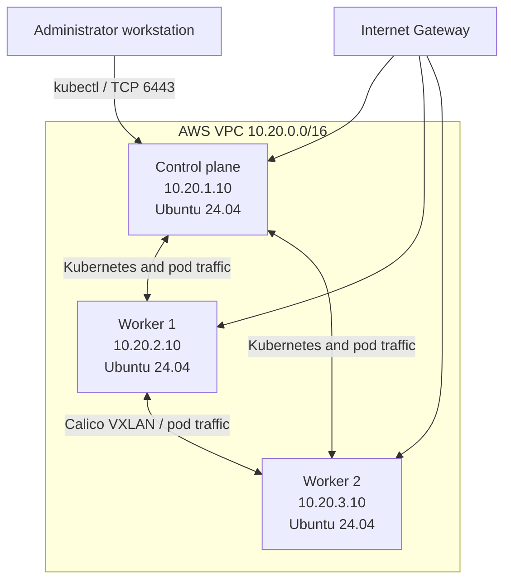

# Lab 1 - Self-Managed Kubernetes on AWS with Terraform and kubeadm

Hands-on learning lab for building a real Kubernetes cluster on AWS EC2. This is not a Minikube or Kind cluster.

The target cluster has one control-plane node and two worker nodes. Terraform creates the AWS infrastructure; kubeadm installs and joins Kubernetes; Calico provides pod networking; kubectl administers the cluster.

> **Learning and security notice:** this is a public-subnet lab, not a production-ready or highly available design. A single control plane is a single point of failure. All nodes have public addresses, and node-to-node traffic is broadly allowed by the cluster security group. Restrict the administrator CIDR, watch AWS costs, and do not use this design for production workloads.

## How to Use This Guide

For every phase, answer three questions before continuing:

1. **What do I run or configure?** Follow the commands in order.
2. **Why am I doing it?** Read the explanation before running commands that change infrastructure or cluster state.
3. **How do I know it worked?** Run the verification commands and compare with the expected result.

Workstation commands use Bash syntax unless noted. Commands marked **on every node** must run on the control plane and both workers. Commands marked **on control plane** run only on the control-plane EC2 instance. Do not copy tokens, kubeconfig files, or credentials into Git.

The shared cluster chat confirms Kubernetes v1.37.2 on Ubuntu 24.04.5, containerd 2.2.1, and Calico v3.33.0 / Tigera Operator v1.44.0. It records that all three nodes eventually became Ready, Calico reported Available and not Degraded, CoreDNS was Running, and kube-proxy was running on every node. The chat does not preserve the exact initial kubeadm commands or the action/timing that resolved the webhook error. The Kubernetes commands below are therefore a repeatable procedure based on the recorded versions and configuration, not a verbatim shell history. The final cross-node pod connectivity test was suggested but its successful output was not included.

## 1. Target Architecture



The three subnets are assigned to the first three available Availability Zones in `us-east-1`. The lab intends these to be `us-east-1a`, `us-east-1b`, and `us-east-1c`, but AWS account-to-AZ name mappings can differ. The Terraform data source chooses available zones by list order; verify actual AZs in the AWS console if exact AZ names matter.

| Component | Lab value | Why it is used |
| --- | --- | --- |
| AWS region | `us-east-1` | Hosts this lab's VPC, EC2, and related resources |
| VPC | `10.20.0.0/16` | Private address space for the Kubernetes nodes |
| Public subnets | `10.20.1.0/24`, `10.20.2.0/24`, `10.20.3.0/24` | One subnet per node and a small, easy-to-understand lab network |
| Control plane | `10.20.1.10` | Stable private address for API server and node communication |
| Worker 1 | `10.20.2.10` | Stable private address for the first worker |
| Worker 2 | `10.20.3.10` | Stable private address for the second worker |
| Pod network | `192.168.0.0/16` | Addresses allocated to pods by Calico; must match kubeadm and Calico |
| Service network | kubeadm default `10.96.0.0/12` | Virtual IP range for Kubernetes Services; not the VPC or pod range |
| EC2 type | `t3.medium` | Lab starting point with 2 vCPUs and 4 GiB RAM per node |
| Root volume | 30 GiB encrypted `gp3` | OS, Kubernetes components, and container images |
| API endpoint | Control-plane Elastic IP on TCP 6443 | Stable endpoint for kubectl and kubeadm discovery |

### Important Components and Why We Use Them

#### AWS infrastructure components

| Component | Role in this lab | Why it is used |
| --- | --- | --- |
| VPC | Private network containing all three nodes | Isolates the lab network and gives nodes a shared private address space |
| Public subnets | Place one EC2 node in each selected Availability Zone | Provide separate node networks and internet routing for this learning setup |
| Internet Gateway and route table | Route non-VPC traffic through the VPC internet gateway | Let nodes download OS packages and container images without a NAT Gateway |
| Security group | Firewall for all node network interfaces | Restricts API access to `admin_cidr` while allowing cluster members to communicate; the all-protocol internal rule is intentionally broad for the lab |
| EC2 instances | Run the control plane and worker operating systems | Provide the compute capacity for Kubernetes components and workloads |
| Elastic IP | Stable public address for the control-plane API | Keeps the external API endpoint stable while the instance's automatically assigned public address could change |
| IAM role and instance profile | Give each EC2 instance Systems Manager permissions | Allow SSM Session Manager access without opening SSH or copying SSH keys |
| Encrypted `gp3` EBS volume | Persistent root disk for each EC2 instance | Stores Ubuntu, Kubernetes files, container images, and local node data |

#### Kubernetes and networking components

| Component | What it does | Why this cluster uses it |
| --- | --- | --- |
| `kubeadm` | Initializes the first control plane and joins additional nodes | Provides the standard bootstrap workflow without a managed Kubernetes service |
| `kube-apiserver` | Serves the Kubernetes API on TCP 6443 and validates requests | It is the entry point used by `kubectl`, kubelets, controllers, and add-ons |
| `etcd` | Stores Kubernetes cluster state | The single control-plane node runs the datastore for this learning cluster; this is not highly available |
| `kube-scheduler` | Chooses a suitable node for each unscheduled pod | Lets Kubernetes place workloads on the two workers and control plane according to scheduling rules |
| `kube-controller-manager` | Runs controllers that compare desired and actual cluster state | Recreates or updates managed resources when the cluster changes |
| `kubelet` | Node agent that talks to the API server and manages pods on its node | Runs on all three EC2 instances and keeps assigned workloads running |
| containerd and CRI | containerd creates and runs containers; CRI is the interface kubelet uses to communicate with a runtime | Kubernetes delegates container lifecycle work to a runtime instead of implementing it itself |
| systemd cgroup driver | Makes containerd and kubelet account for CPU/memory using the same Linux manager | Keeps resource accounting consistent with Ubuntu's systemd-based setup |
| `kube-proxy` | Implements Kubernetes Service virtual-IP routing; this cluster reported `iptables` mode | Lets a ClusterIP such as `10.96.0.1` reach a real API endpoint. Its API endpoint must be reachable so it can watch Services and program node rules |
| CoreDNS | Resolves Kubernetes service names such as `kubernetes.default.svc.cluster.local` | Gives pods cluster DNS-based service discovery |
| CNI | Container Network Interface standard for pod networking plugins | Kubernetes needs a CNI implementation to assign pod IPs and connect pods; without one, nodes commonly remain `NotReady` |
| Tigera Operator | Watches Calico custom resources and manages Calico components | Installs and reconciles Calico from the `Installation` resource instead of requiring each component to be managed manually |
| Calico `calico-node` | Runs networking and policy functions on each Kubernetes node | Connects pod interfaces and applies network policy/data-plane configuration on all three nodes |
| Calico VXLAN CrossSubnet | Encapsulates pod traffic across different node subnets | Carries pod-network packets across the VPC while using the configured `192.168.0.0/16` pod CIDR |
| Calico IP pool | Defines pod addresses and NAT behavior | The `192.168.0.0/16` pool matches `kubeadm`'s `podSubnet`; `natOutgoing: Enabled` supports outbound pod traffic |
| Calico webhooks | Validate selected Calico API requests | Help reject invalid Calico resource changes; their Service must have ready pod endpoints for admission requests to succeed |
| Calico Typha and controllers | Distribute datastore updates and reconcile Calico-specific resources | Included in the operator-managed Calico deployment; controllers manage Calico resources and Typha helps distribute updates |

**How they fit together:** `kubectl` sends desired-state requests to the API server. The API server stores state in etcd. Controllers and the scheduler act on that state; kubelet asks containerd through CRI to run the assigned containers. Calico supplies pod networking, while kube-proxy routes Service IP traffic. CoreDNS turns service names into addresses. The `kube-proxy` incident later in this guide is a useful example: the pod could be `Running`, but if kube-proxy could not reach the API, Service IP routing could still fail.

### Why three Availability Zones?

Spreading nodes across zones lets us practice multi-zone scheduling and pod networking. It also means the two workers can remain available if a single worker AZ has a problem. It does **not** make Kubernetes highly available: the only control plane is still a single point of failure in the first AZ.

### Why public subnets and no NAT Gateway?

Each node has a public IP and a route to the Internet Gateway. That lets it download OS packages, Kubernetes packages, and container images without a NAT Gateway. A NAT Gateway is normally used when instances in private subnets need outbound internet access without direct public addresses. This lab intentionally does not create private application/database subnets or a NAT Gateway. Public IPv4 addresses can incur AWS charges.

### Why private node IPs and a public Elastic IP?

Kubernetes nodes use their fixed private IPs (`10.20.x.10`) for communication inside the VPC. The control-plane Elastic IP is stable for the API endpoint used by an administrator. The API security-group rule limits direct administrator access to `admin_cidr`; node-to-node traffic is allowed by the shared security-group rule.

### Why not an API load balancer?

There is one control-plane backend, so a load balancer would not remove the control plane as a failure point. A later highly available design should use multiple control planes and a stable load-balanced API endpoint.

## 2. Before Provisioning

### 2.1 Install workstation tools

Install Terraform 1.6 or newer and AWS CLI v2. Configure AWS credentials using an AWS CLI profile, environment credentials, or an assigned workstation role. Do not put access keys in Terraform files.

**Why:** Terraform calls AWS APIs using your identity. The AWS CLI is used to confirm that identity and later inspect instances and start SSM sessions.

**Verify your identity before creating resources:**

```bash
aws sts get-caller-identity
```

Expected: an account ID and ARN for the AWS identity you intend to use. If this command fails or shows the wrong account, stop and correct AWS authentication before `terraform apply`.

### 2.2 Set the administrator CIDR

In `terraform/terraform.tfvars`, change `admin_cidr` to your current public IPv4 address with `/32`, for example `203.0.113.10/32`. The address in the workspace file is only an example and may not be your current address.

You can ask an external service for the current public IPv4 address:

```bash
curl -4 https://checkip.amazonaws.com
```

Add `/32` to the returned address. If you connect through an office or VPN, use the public egress IP seen by AWS, not your laptop's private LAN IP.

**Why:** `admin_cidr` is the source allowed to reach the Kubernetes API on TCP port 6443. `/32` limits that rule to one IPv4 address. Do not set it to `0.0.0.0/0` for normal use.

**Verify:** the value is valid IPv4 CIDR notation and ends in `/32`. If your public IP changes, update the value and apply the security-group change; stale administrator IPs commonly cause API timeouts.

## 3. Understand the Terraform Files

The files already in `terraform/` define infrastructure. This guide describes them; it does not require changing them.

| File | What it defines | Why it is separate |
| --- | --- | --- |
| `versions.tf` | Terraform minimum version and AWS provider source/version | Makes tool/provider requirements explicit and repeatable |
| `provider.tf` | AWS region and default tags | Centralizes which AWS account/region API provider settings are used |
| `variables.tf` | Typed inputs and validation for region, CIDRs, instance type, and disk size | Separates values from resource definitions and catches invalid input |
| `terraform.tfvars` | Actual lab values, including administrator CIDR | Supplies this deployment's inputs without embedding them in every resource |
| `main.tf` | VPC, internet gateway, subnets, route table, and route associations | Contains the base network other resources depend on |
| `security-groups.tf` | Kubernetes node security group and ingress/egress rules | Describes the network firewall separately from instances |
| `iam.tf` | EC2 role, SSM policy attachment, and instance profile | Gives EC2 the permissions needed to register with Systems Manager |
| `ec2.tf` | Ubuntu AMI lookup, three EC2 nodes, EBS settings, and control-plane Elastic IP | Defines the machines and the stable public API address |
| `outputs.tf` | VPC/subnet/node IDs and API endpoint | Makes resource IDs and addresses easy to retrieve after apply |

### What each Terraform resource is for

- **Availability Zone data source:** asks AWS for currently available zones rather than hardcoding one list. The code selects by list index; the exact AZ names are account-dependent.
- **VPC and DNS settings:** create the isolated network. DNS support allows AWS DNS resolution; DNS hostnames allow AWS-assigned hostnames.
- **Internet Gateway:** connects the VPC to the internet. It does not by itself give an instance internet access; the subnet route and public IP are also required.
- **Public subnets:** split the VPC into smaller networks and use `map_public_ip_on_launch = true` for public addresses.
- **Route table and associations:** `0.0.0.0/0` sends non-local IPv4 destinations to the Internet Gateway. Associations attach that route table to all three subnets.
- **Node security group:** TCP 6443 is allowed from `admin_cidr`; all protocols are allowed between instances using this same security group; outbound traffic is allowed. The all-protocol internal rule simplifies the lab but is broader than a production least-privilege policy. Do not open etcd or internal control-plane ports to the public internet.
- **EC2 SSM role and instance profile:** let the EC2 service assume a role with `AmazonSSMManagedInstanceCore`. The instance profile attaches that role to each VM so SSM can provide Session Manager access without an inbound SSH rule.
- **Ubuntu AMI data source:** finds the most recent Canonical Ubuntu 24.04 AMD64 HVM image. This avoids a region-specific hardcoded AMI ID; it also means a future apply may select a newer Ubuntu image.
- **EC2 nodes:** use stable private addresses, public addresses for this learning lab, IMDSv2-required metadata, and encrypted `gp3` root disks. The control-plane Elastic IP stays stable when its automatic public address would not.
- **Outputs:** expose IDs and addresses, including the control-plane Elastic IP plus `:6443`, so later commands don't require manually searching the console.

**Important:** Terraform state is local in this project. State records resource IDs and configuration details. Keep `terraform.tfstate`, backups, and `terraform.tfvars` out of Git. The state is required to manage or destroy the infrastructure; do not delete it while resources exist. For team/production use, move to a protected remote backend with encryption, versioning, and locking.

## 4. Run Terraform

Open a terminal at the repository root, then run each command in order:

### Step 1 - Enter the Terraform directory

```bash
cd terraform
```

**Why:** Terraform loads the `.tf` configuration and `terraform.tfvars` from the current working directory.

### Step 2 - Confirm AWS identity

```bash
aws sts get-caller-identity
```

**Why:** prevents accidentally creating paid resources in the wrong AWS account. Confirm the account and role/user in the output before continuing.

### Step 3 - Format the configuration

```bash
terraform fmt -recursive
```

**Why:** standardizes HCL formatting so changes are easier to inspect. This changes formatting only; it does not create AWS resources.

### Step 4 - Initialize Terraform

```bash
terraform init
```

**Why:** downloads the required AWS provider and prepares the local Terraform working directory. Re-run it if provider/backend requirements change.

### Step 5 - Validate the configuration

```bash
terraform validate
```

**Why:** checks whether the Terraform configuration is structurally valid. It does not confirm AWS credentials, quotas, IP availability, or that the plan is affordable.

Expected: `Success! The configuration is valid.`

### Step 6 - Review the execution plan

```bash
terraform plan
```

**Why:** previews the actual changes before Terraform makes them. Read the plan and make sure it creates the expected lab resources and is not unexpectedly replacing or deleting existing resources.

Expected initial resources: one VPC, one Internet Gateway, three subnets, one public route table, three route associations, one security group with rules, one IAM role, one instance profile, three EC2 instances, one Elastic IP, and one Elastic IP association. Exact counts can differ for provider implementation details.

### Step 7 - Create the infrastructure

```bash
terraform apply
```

**Why:** applies the plan and creates billable AWS resources. Read the plan again and type `yes` only after confirming the account, region, administrator CIDR, and resources.

### Step 8 - Read the outputs

```bash
terraform output
terraform output -raw control_plane_api_endpoint
```

**Why:** outputs include instance IDs/IPs and the API endpoint used in later steps.

**Verify:** expect one control plane and two workers, with private IPs `10.20.1.10`, `10.20.2.10`, and `10.20.3.10`. The `control_plane_api_endpoint` output already includes `:6443`; do not append a second port.

Optional AWS-side check:

```bash
aws ec2 describe-instances \
	--filters "Name=tag:Project,Values=self-managed-k8s" \
	--query "Reservations[].Instances[].[InstanceId,PrivateIpAddress,PublicIpAddress,State.Name]" \
	--output table
```

**Why:** checks instance state and addresses directly from AWS, independently of Terraform's output formatting.

### Step 9 - Connect with Systems Manager

List SSM-managed instances:

```bash
aws ssm describe-instance-information --region us-east-1
```

Start a session, replacing the value with an instance ID from Terraform output:

```bash
aws ssm start-session \
	--target <INSTANCE_ID> \
	--region us-east-1
```

**Why:** Session Manager provides a shell without opening inbound TCP port 22 or copying SSH keys. Connect to each EC2 instance this way.

**Verify:** each instance appears as an online managed instance and the session opens an Ubuntu shell. If an instance is absent, see the SSM troubleshooting section below.

## 5. Kubernetes Installation Lab: Connect and Prepare Nodes

Run the common operating-system preparation on **all three EC2 instances**. Later, kubeadm initialization runs only on the control plane; the join command runs on each worker.

### Step 1 - Connect to all three instances through SSM

Run these commands from your **workstation terminal**, not inside an EC2 session. Open three terminal windows, or start one session at a time and reconnect as needed:

```bash
aws ssm start-session --target <CONTROL-PLANE-INSTANCE-ID> --region us-east-1
aws ssm start-session --target <WORKER-1-INSTANCE-ID> --region us-east-1
aws ssm start-session --target <WORKER-2-INSTANCE-ID> --region us-east-1
```

Replace each placeholder with its EC2 instance ID from `terraform output`.

**Why:** SSM gives you a shell on each node without opening SSH port 22 or distributing SSH private keys. Separate sessions also reduce the chance of accidentally running a control-plane command on a worker.

**Verify:** each command opens an Ubuntu shell. If an instance is not available, follow [SSM troubleshooting](#103-ec2-does-not-appear-in-systems-manager).

### Step 2 - Verify OS, hostname, IP, and available memory

Run these commands **inside each of the three SSM sessions**:

```bash
cat /etc/os-release
hostname
ip -4 addr
free -h
```

**Why each command is useful:**

- `cat /etc/os-release` confirms the OS release, which determines package/repository instructions.
- `hostname` identifies which machine the terminal is connected to. EC2 initially assigned generated names such as `ip-10-20-1-10`.
- `ip -4 addr` confirms the node's private IPv4 address and network interface.
- `free -h` checks available RAM before installing control-plane and networking components.

**Observed output from this cluster:**

| Node | Initial Ubuntu hostname | Private IP | OS | RAM available | Swap |
| --- | --- | --- | --- | --- | --- |
| Control plane | `ip-10-20-1-10` | `10.20.1.10` | Ubuntu 24.04.5 LTS | about 3.3 GiB | `0B` |
| Worker 1 | `ip-10-20-2-10` | `10.20.2.10` | Ubuntu 24.04.5 LTS | about 3.3 GiB | `0B` |
| Worker 2 | `ip-10-20-3-10` | `10.20.3.10` | Ubuntu 24.04.5 LTS | about 3.3 GiB | `0B` |

The output showed the expected `ens5` interface and private addresses. `free -h` shows human-readable memory; `available` is the useful estimate of memory applications can use without swapping. These `t3.medium` machines are suitable for lightweight learning workloads, not large production workloads.

**Verify before continuing:** all nodes show Ubuntu 24.04, the correct private IP, and enough free/available memory. If an IP differs, compare it with Terraform output before setting hostnames or kubeadm addresses.

### Step 3 - Set meaningful hostnames

Run **only the matching command** inside each node's SSM session:

```bash
# On 10.20.1.10
sudo hostnamectl set-hostname k8s-control-plane

# On 10.20.2.10
sudo hostnamectl set-hostname k8s-worker-1

# On 10.20.3.10
sudo hostnamectl set-hostname k8s-worker-2
```

**Why:** a hostname identifies a machine by name. Kubelet normally registers the OS hostname as the Kubernetes node name. Terraform's EC2 `Name` tag does not change Ubuntu's hostname.

**Verify on each node:**

```bash
hostname
hostnamectl --static
```

Expected names: `k8s-control-plane`, `k8s-worker-1`, and `k8s-worker-2` on their corresponding IPs.

### Step 4 - Add static node-name resolution in `/etc/hosts`

Run this **once on each node**:

```bash
sudo tee -a /etc/hosts <<'EOF'
10.20.1.10 k8s-control-plane
10.20.2.10 k8s-worker-1
10.20.3.10 k8s-worker-2
EOF
```

**Why:** `/etc/hosts` maps names to IP addresses locally. It provides simple node-name resolution for diagnostics without depending on external DNS. It does not replace Kubernetes DNS, and it does not replace the Kubernetes API endpoint.

**Verify on each node:**

```bash
getent hosts k8s-control-plane
getent hosts k8s-worker-1
getent hosts k8s-worker-2
```

Each command should return the matching `10.20.x.10` address. The `tee -a` command appends entries; run it once per machine to avoid duplicate lines if repeating the setup.

### Step 5 - Check swap and disable it only if active

The observed output already showed `Swap: 0B` on all three nodes. Check the current state on each node:

```bash
swapon --show
grep -nE '\sswap\s' /etc/fstab || true
```

**Why:** kubelet expects swap disabled in this kubeadm configuration. `swapon --show` reports active swap now; `/etc/fstab` reveals whether swap may be enabled again after reboot.

If `swapon --show` lists a device or file, disable it now and comment out the corresponding swap line in `/etc/fstab` using `sudoedit /etc/fstab`:

```bash
sudo swapoff -a
sudoedit /etc/fstab
```

In `sudoedit`, put `#` at the beginning of the active swap entry, then save and exit. Do not edit unrelated filesystem entries.

**Verify:** `swapon --show` prints no rows. Any swap line in `/etc/fstab` is commented out. If both checks are already clear, no swap change is needed.

### Step 6 - Load Linux kernel modules

Run on **all three nodes**:

```bash
sudo tee /etc/modules-load.d/k8s.conf <<'EOF'
overlay
br_netfilter
EOF

sudo modprobe overlay
sudo modprobe br_netfilter
```

**What these terms mean:** the Linux kernel is the core OS that manages processes and hardware; a kernel module adds a capability to it.

| Module | Why Kubernetes needs it |
| --- | --- |
| `overlay` | Supports overlay filesystems used for container image layers |
| `br_netfilter` | Allows Linux packet-filter rules to process traffic passing through bridges |

The file under `/etc/modules-load.d/` loads the modules on future boots. `modprobe` loads them immediately without a reboot.

**Verify:**

```bash
lsmod | grep -E 'overlay|br_netfilter'
```

Both modules should appear. If not, inspect the `modprobe` error before continuing.

### Step 7 - Configure Linux networking parameters

Run on **all three nodes**:

```bash
sudo tee /etc/sysctl.d/k8s.conf <<'EOF'
net.bridge.bridge-nf-call-iptables = 1
net.bridge.bridge-nf-call-ip6tables = 1
net.ipv4.ip_forward = 1
EOF

sudo sysctl --system
```

**Why each setting is used:**

| Setting | Meaning and purpose |
| --- | --- |
| `net.bridge.bridge-nf-call-iptables = 1` | Sends bridged IPv4 traffic through iptables filtering, which lets Kubernetes networking rules see it |
| `net.bridge.bridge-nf-call-ip6tables = 1` | Enables the equivalent bridge filtering hook for IPv6 |
| `net.ipv4.ip_forward = 1` | Lets the node route IPv4 packets between pod and node networks |

`sysctl --system` loads the persistent configuration immediately. The file also reapplies it at boot.

**Verify on each node:**

```bash
sysctl net.bridge.bridge-nf-call-iptables
sysctl net.bridge.bridge-nf-call-ip6tables
sysctl net.ipv4.ip_forward
```

Each value should be `1`. If a bridge setting is missing, verify `br_netfilter` is loaded and rerun `sudo sysctl --system`.

### Step 8 - Confirm the Linux prerequisites on all nodes

Run on the **control plane and both workers**:

```bash
hostname
lsmod | grep -E 'overlay|br_netfilter'
sysctl net.ipv4.ip_forward
sysctl net.bridge.bridge-nf-call-iptables
sysctl net.bridge.bridge-nf-call-ip6tables
swapon --show
```

**Why:** this final check makes sure the three machines are configured consistently before adding the container runtime and kubelet. `swapon --show` returning no rows means there are no active swap devices/files, which is the expected result for this kubeadm setup.

**Observed results:**

| Check | Control plane | Worker 1 | Worker 2 | Meaning |
| --- | --- | --- | --- | --- |
| Hostname | `k8s-control-plane` | `k8s-worker-1` | `k8s-worker-2` | Each machine has a distinct expected node name |
| `overlay` and `br_netfilter` | Loaded | Loaded | Loaded | Container filesystem and bridge filtering modules are present |
| IPv4 forwarding | `1` | `1` | `1` | Nodes can route IPv4 pod traffic |
| Bridge iptables hooks | `1` | `1` | `1` | Bridged IPv4 and IPv6 packets are visible to packet filtering |
| Active swap | None | None | None | Kubelet will not be using swap |

All three nodes passed these prerequisite checks. If a node differs, correct it and repeat the check on that node before proceeding.

### Step 9 - Understand and install containerd

Kubernetes is the system that manages desired application state, but it does not directly create containers. Kubelet asks a container runtime to create, start, and stop containers through the **Container Runtime Interface (CRI)**. This lab uses containerd as that runtime.

The shared session already installed containerd on all three nodes. On a fresh node, install it with:

```bash
sudo apt update
sudo apt install -y containerd
```

**Why:** `apt update` refreshes Ubuntu's package index; `apt install` installs the runtime; `-y` confirms the package installation without an interactive prompt.

### Step 10 - Check the containerd version and configuration before changing it

Run on **all three nodes**:

```bash
containerd --version
systemctl status containerd --no-pager
grep -nE 'disabled_plugins|SystemdCgroup' /etc/containerd/config.toml
```

**Why:** containerd 1.x and 2.x use different configuration plugin paths. Inspect the installed version and existing configuration first so a version-specific edit is not applied blindly. The grep also checks whether CRI is disabled and what cgroup driver is currently selected.

**Observed on all three nodes:** containerd `2.2.1`; service enabled and `active (running)`; `disabled_plugins = []`; `SystemdCgroup = false`. The empty disabled-plugin list means the CRI plugin was not disabled. The cgroup setting still needs to be changed before installing kubelet.

### Step 11 - Configure the containerd 2.x systemd cgroup driver

Run on **all three nodes**. First back up the current configuration:

```bash
sudo cp /etc/containerd/config.toml /etc/containerd/config.toml.bak
```

**Why:** the backup gives you a recovery copy if a configuration edit is wrong.

Change the existing setting:

```bash
sudo sed -i 's/SystemdCgroup = false/SystemdCgroup = true/' /etc/containerd/config.toml
```

**What this command does:** `sed` edits text; `-i` writes the change to the file; `s/old/new/` replaces `SystemdCgroup = false` with `SystemdCgroup = true`.

For containerd 2.x, this setting belongs to the CRI v1 runtime's runc options section:

```toml
[plugins.'io.containerd.cri.v1.runtime'.containerd.runtimes.runc.options]
SystemdCgroup = true
```

**Why:** a cgroup (control group) measures and limits process resources such as CPU and memory. Kubelet and containerd must manage cgroups consistently. Ubuntu uses systemd, so both components should use the systemd cgroup driver. The containerd 2.x plugin path is different from the one used by many containerd 1.x examples.

**Verify the file setting on each node:**

```bash
grep -n 'SystemdCgroup' /etc/containerd/config.toml
```

It should show `SystemdCgroup = true` under the v2 CRI runtime runc options. If the `sed` command changed no line, stop and inspect the config rather than continuing with a mismatched runtime configuration.

### Step 12 - Restart containerd and verify CRI

Run on **all three nodes**:

```bash
sudo systemctl restart containerd
sudo systemctl status containerd --no-pager
sudo containerd config dump | grep -n -B 3 -A 3 'SystemdCgroup'
sudo ctr plugins ls | grep cri
```

**Why:** containerd reads its configuration at startup, so the restart makes it load the new cgroup setting. `config dump` shows the effective configuration, and `ctr plugins ls` checks the CRI plugin status rather than only the file text.

**Expected:** containerd is `active (running)`, the effective runtime configuration shows `SystemdCgroup = true`, and the relevant CRI plugins report `ok`. Run these checks on all three nodes; only proceed to kubeadm/kubelet installation after the runtime is healthy and consistent everywhere.

### Step 9 - Install kubeadm, kubelet, and kubectl

The recorded cluster used Kubernetes v1.37.2. These commands configure the Kubernetes v1.37 apt feed. The feed can have newer patch releases, so confirm the version available before installing and use the same supported patch release on all nodes.

```bash
sudo apt-get install -y apt-transport-https ca-certificates curl gpg
sudo mkdir -p -m 755 /etc/apt/keyrings
curl -fsSL https://pkgs.k8s.io/core:/stable:/v1.37/deb/Release.key \
	| sudo gpg --dearmor --yes -o /etc/apt/keyrings/kubernetes-apt-keyring.gpg
echo 'deb [signed-by=/etc/apt/keyrings/kubernetes-apt-keyring.gpg] https://pkgs.k8s.io/core:/stable:/v1.37/deb/ /' \
	| sudo tee /etc/apt/sources.list.d/kubernetes.list
sudo apt-get update
sudo apt-get install -y kubelet kubeadm kubectl
sudo apt-mark hold kubelet kubeadm kubectl
```

**Why:** certificate/download tools and the signed keyring configure a trusted Kubernetes package source. `kubeadm` initializes and joins nodes, `kubelet` runs on every node and manages pods, and `kubectl` sends administrative requests to the API server. Holding packages prevents unattended upgrades from changing only part of the cluster.

**Verify on every node:**

```bash
kubeadm version
kubelet --version
kubectl version --client
```

The Kubernetes versions should match. If you need the exact v1.37.2 used by the recorded cluster, install that exact patch package on all nodes if it is still available; do not initialize with a version different from the installed kubeadm/kubelet versions.

## 6. Initialize the Control Plane

Run the following steps **only on `k8s-control-plane`**, unless a step says otherwise. Do not rerun `kubeadm init` if the cluster has already initialized.

### Step 10 - Verify private connectivity from both workers

Run this on **each worker**:

```bash
ping -c 3 10.20.1.10
```

**Why:** the workers and control plane should communicate over private VPC addresses. This checks basic ICMP reachability before cluster bootstrap; it does not yet test the Kubernetes API port or pod networking.

**Observed result:** both workers received all three replies with `0% packet loss`. If ping fails, check the private IPs, instance state, and node security-group membership before proceeding.

The API endpoint from Terraform is a public Elastic IP. Keep inbound TCP 6443 restricted to the administrator's `/32` CIDR. The EIP observed during the session was `184.197.40.110`, but Elastic IPs can change after infrastructure is destroyed and recreated; always obtain the current value with `terraform -chdir=terraform output -raw control_plane_api_endpoint`.

### Step 11 - Create the kubeadm configuration file

On the **control plane only**, get the current endpoint from Terraform, then create the configuration file:

```bash
terraform -chdir=terraform output -raw control_plane_api_endpoint
sudo mkdir -p /etc/kubernetes
sudo nano /etc/kubernetes/kubeadm-config.yaml
```

Paste this YAML into the editor. Replace `<CONTROL_PLANE_EIP>` with the current public IP only, without `:6443`:

```yaml
apiVersion: kubeadm.k8s.io/v1beta4
kind: InitConfiguration
localAPIEndpoint:
	advertiseAddress: "10.20.1.10"
	bindPort: 6443
nodeRegistration:
	name: "k8s-control-plane"
	criSocket: "unix:///run/containerd/containerd.sock"
---
apiVersion: kubeadm.k8s.io/v1beta4
kind: ClusterConfiguration
kubernetesVersion: "v1.37.2"
controlPlaneEndpoint: "<CONTROL_PLANE_EIP>:6443"
networking:
	podSubnet: "192.168.0.0/16"
	serviceSubnet: "10.96.0.0/12"
	dnsDomain: "cluster.local"
apiServer:
	certSANs:
		- "<CONTROL_PLANE_EIP>"
```

Save in nano with `Ctrl+O`, Enter, then `Ctrl+X`.

| Setting | Meaning and why it is used |
| --- | --- |
| `InitConfiguration` | Settings for the specific machine running the first control-plane initialization |
| `advertiseAddress: 10.20.1.10` | The control plane's private address, used for internal node communication |
| `bindPort: 6443` | The TCP port on which the API server listens |
| `nodeRegistration.name` | Sets the Kubernetes node name explicitly |
| `criSocket` | Tells kubeadm to use containerd's Unix socket rather than guess a runtime |
| `ClusterConfiguration` | Settings shared by the Kubernetes cluster |
| `kubernetesVersion` | Pins the requested control-plane version to the version installed on the nodes |
| `controlPlaneEndpoint` | Stable endpoint that joining nodes and external clients can use |
| `podSubnet` | Pod IP range; must match Calico's pool |
| `serviceSubnet` | ClusterIP range for Kubernetes Services; separate from VPC and pod ranges |
| `dnsDomain` | Domain suffix used for in-cluster service DNS names |
| `apiServer.certSANs` | Adds the public Elastic IP to the API certificate so clients using that IP can validate TLS |

**Important distinction:** `advertiseAddress` is the control plane's private IP. `controlPlaneEndpoint` is the stable public EIP and port. `certSANs` makes the EIP valid for TLS certificate checks. Keep this file and its values consistent with the IPs and CIDRs created by Terraform.

### Step 12 - Validate the file and runtime prerequisites

Run on the **control plane**:

```bash
sudo kubeadm config validate --config /etc/kubernetes/kubeadm-config.yaml
ls -l /run/containerd/containerd.sock
sudo kubeadm config images list --config /etc/kubernetes/kubeadm-config.yaml
```

**Why:** validate catches YAML/schema errors before a cluster is created; checking the socket confirms kubeadm can address containerd; listing images shows which Kubernetes component images will be required.

**Observed results:** config validation returned `ok`; the containerd socket existed at `/run/containerd/containerd.sock`; the image list included the v1.37.2 API server, controller manager, scheduler, kube-proxy, CoreDNS, pause, and etcd images. If validation fails or the socket is missing, stop and fix that issue before initialization.

### Step 13 - Download control-plane images

On the **control plane only**:

```bash
sudo kubeadm config images pull --config /etc/kubernetes/kubeadm-config.yaml
```

**Why:** downloads the required images before initialization. Doing this separately distinguishes registry/network download failures from kubeadm bootstrap failures.

**Verify:** the command completes without image-pull errors. If it fails, check outbound connectivity and the reported registry/image before running `kubeadm init`.

### Step 14 - Initialize Kubernetes once

On the **control plane only**:

```bash
sudo kubeadm init --config /etc/kubernetes/kubeadm-config.yaml
```

This is an important, state-changing operation. `kubeadm init` checks prerequisites, creates cluster certificates, configures the API server, starts etcd and the scheduler/controller manager as static pods, configures kubelet, and prints instructions for kubectl and worker joining. It can take a few minutes.

**Expected success:** output says the control plane initialized successfully and prints kubeconfig instructions and worker join commands. Save a join command securely, but do not paste its token into Git, README, or public chat. Do not run this command on a worker. If it fails, save the full error and diagnose it before trying again; do not reset or rerun blindly.

### Step 15 - Configure kubectl for the SSM user

After initialization succeeds, run on the **control plane** as the regular SSM user:

```bash
mkdir -p "$HOME/.kube"
sudo cp -i /etc/kubernetes/admin.conf "$HOME/.kube/config"
sudo chown "$(id -u):$(id -g)" "$HOME/.kube/config"
```

**Why:** `admin.conf` holds the cluster address, certificate authority, and administrator credentials. Placing it in the current user's default kubeconfig path allows `kubectl` to run without `sudo`. It grants cluster-admin access, so protect the file.

Test:

```bash
kubectl get nodes
```

Before Calico is installed, a listed control-plane node may show `NotReady`; that is expected because no pod network plugin is installed yet. In the shared session, this command instead timed out trying to reach the public EIP from inside the control-plane instance. Follow the private-endpoint diagnostic in [API endpoint troubleshooting](#104-api-server-is-unreachable-from-your-workstation); do not rerun `kubeadm init` because of a kubectl timeout.

## 7. Join the Two Workers

The shared session showed the workers can reach the control plane at private IP `10.20.1.10` with no packet loss. To avoid the public-IP hairpin path that timed out for kubectl inside the control-plane instance, join workers using the control plane's **private** IP. On the control plane, generate a fresh join command when ready:

```bash
sudo kubeadm token create --print-join-command
```

On **each worker**, use the token and CA hash from that fresh output, but use `10.20.1.10:6443` as the endpoint:

```bash
sudo kubeadm join 10.20.1.10:6443 \
	--token <TOKEN> \
	--discovery-token-ca-cert-hash sha256:<CA_CERTIFICATE_HASH>
```

Use the fresh token and hash printed by the control plane; replace placeholders and keep them private. The pasted session contained a real bootstrap token, so treat it as exposed. If it is still valid, revoke it on the control plane before creating a new one:

```bash
sudo kubeadm token list
sudo kubeadm token delete <TOKEN_ID>
sudo kubeadm token create --print-join-command
```

`TOKEN_ID` is the ID portion before the dot in the token shown by `kubeadm token list`; do not put the actual token in this README. The public EIP remains the endpoint for an administrator connecting from outside the VPC. Keep the API security-group rule restricted to the trusted administrator CIDR.

**Why:** the bootstrap token temporarily authorizes a node to join. The CA hash verifies the cluster identity, preventing the joining node from trusting the wrong API server. `kubeadm join` writes local node configuration and starts kubelet registration.

**Verify from the control plane:**

```bash
kubectl get nodes -o wide
```

Both workers should appear with private IPs `10.20.2.10` and `10.20.3.10`. Their status can remain `NotReady` while there is no CNI plugin. If the token expires, generate a fresh command on the control plane:

```bash
sudo kubeadm token create --print-join-command
```

## 8. Install Calico Pod Networking

Run on the control plane with kubectl configured. The shared chat records Calico v3.33.0 and Tigera Operator v1.44.0.

### Step 1 - Install the Tigera Operator

```bash
kubectl create -f https://raw.githubusercontent.com/projectcalico/calico/v3.33.0/manifests/tigera-operator.yaml
```

**Why:** the operator installs Calico's CRDs and controllers, then reconciles the desired Calico configuration. Pinning the manifest URL to a release avoids silently following an unrelated latest version.

### Step 2 - Download and inspect the Calico custom resource

```bash
curl -fsSLO https://raw.githubusercontent.com/projectcalico/calico/v3.33.0/manifests/custom-resources.yaml
```

Edit `custom-resources.yaml` so `spec.calicoNetwork.ipPools` has these settings:

```yaml
cidr: 192.168.0.0/16
encapsulation: VXLANCrossSubnet
natOutgoing: Enabled
```

**Why:** the `cidr` must match kubeadm's pod network; VXLAN carries pod traffic across node subnets; outgoing NAT allows pods to reach destinations outside the pod network. The pod CIDR is not the VPC CIDR. Do not install a second CNI over Calico.

### Step 3 - Apply the custom resource

```bash
kubectl apply -f custom-resources.yaml
```

**Why:** applying the custom resource tells the operator which network configuration to create. The operator then creates Calico node agents and controllers on the cluster.

**Verify:**

```bash
kubectl get pods -n tigera-operator
kubectl get pods -n calico-system -o wide
kubectl get nodes -o wide
```

Pods may need time to start and images may need to download. Do not immediately delete or reinstall resources when you see early readiness warnings; use the troubleshooting workflow below to inspect current pod status and events.

## 9. Verify Cluster Health

Run from the control plane:

```bash
kubectl get nodes -o wide
kubectl get pods -A -o wide
kubectl get tigerastatus
kubectl get ippools.projectcalico.org -o yaml
```

| Command | Why to run it | Healthy result |
| --- | --- | --- |
| `kubectl get nodes -o wide` | Checks registration, readiness, Kubernetes version, and node addresses | Three nodes, all `Ready`, with the expected private IPs |
| `kubectl get pods -A -o wide` | Checks system and Calico pod readiness, restarts, IPs, and placement | Calico, CoreDNS, and kube-proxy pods running and ready |
| `kubectl get tigerastatus` | Checks the Tigera Operator's view of Calico components | Relevant components Available=True and Degraded=False |
| `kubectl get ippools.projectcalico.org -o yaml` | Reads the effective Calico pod-pool configuration | CIDR `192.168.0.0/16`, VXLAN CrossSubnet, outgoing NAT enabled |

**What was confirmed in the chat:** all three nodes were `Ready`; Calico and IP pools reported available, not progressing, and not degraded; CoreDNS was `2/2 Running`; kube-proxy was `3/3 Running`; the webhook had two endpoints. The chat did not include output proving the final pod-to-pod and DNS test below succeeded.

### Optional but recommended: test pod traffic across workers

Create one temporary BusyBox pod on each worker:

```bash
kubectl run network-test-1 \
	--image=busybox:1.36 \
	--restart=Never \
	--overrides='{"spec":{"nodeName":"k8s-worker-1"}}' \
	--command -- sleep 3600

kubectl run network-test-2 \
	--image=busybox:1.36 \
	--restart=Never \
	--overrides='{"spec":{"nodeName":"k8s-worker-2"}}' \
	--command -- sleep 3600

kubectl get pods -o wide
```

**Why:** node readiness means kubelet and CNI readiness checks pass, but it does not prove a workload on one worker can talk to a workload on another. Pinning each pod to a different worker makes this a cross-node test.

Copy the `network-test-2` pod IP from the previous output, then run:

```bash
kubectl exec network-test-1 -- ping -c 3 <NETWORK_TEST_2_POD_IP>
kubectl exec network-test-1 -- nslookup kubernetes.default.svc.cluster.local
```

**Expected:** both pods are Running, have different IPs in `192.168.0.0/16`, ping receives replies, and DNS returns a Kubernetes service address. When finished, remove the temporary pods:

```bash
kubectl delete pod network-test-1 network-test-2
```

## 10. Troubleshooting: Work From Evidence

Use this loop for any issue:

1. Identify the exact failing object or command.
2. Read current status, `describe` output, logs, and recent events.
3. Decide which layer the evidence points to: AWS network, OS/runtime, kubelet/API, CNI, or application.
4. Change only that layer, then rerun the same check.

Avoid destructive actions (resetting nodes, deleting Calico, rerunning `kubeadm init`) until you know what state will be removed and have saved relevant logs.

### 10.1 Terraform fails before creating resources

Run:

```bash
aws sts get-caller-identity
terraform init
terraform validate
terraform plan
```

- **Why:** identity confirms account/credentials; init checks provider setup; validate checks HCL structure; plan reaches AWS and reveals permissions, quota, subnet, or resource errors before apply.
- **If AWS authentication fails:** configure the intended AWS CLI profile/role and repeat `get-caller-identity`.
- **If validate fails:** use the file and line in the diagnostic; do not apply.
- **If apply reports authorization or quota errors:** inspect the AWS error and required permission/quota in the named region. Do not broaden IAM or security-group access without understanding the denial.

### 10.2 Terraform plan proposes unexpected deletion or replacement

```bash
terraform plan
terraform state list
```

- **Why:** plan describes proposed resource changes; state list shows what this local state currently manages.
- **Next:** stop if a resource is being replaced unexpectedly. Confirm the working directory, AWS account, and state file before applying. Never delete or recreate state just to make a plan look clean.

### 10.3 EC2 does not appear in Systems Manager

```bash
aws ssm describe-instance-information --region us-east-1
```

- **Why:** this tells you whether SSM has registered the instance as a managed node.
- **If missing/offline:** check that the correct SSM instance profile is attached, the instance is running, the SSM Agent is active, and outbound HTTPS to Systems Manager endpoints is possible. The security group has outbound access, but an IAM role alone cannot fix missing network connectivity.
- **Verify:** instance status becomes online and `aws ssm start-session --target <INSTANCE_ID> --region us-east-1` opens a shell.

### 10.4 API server is unreachable from your workstation

```bash
terraform output -raw control_plane_api_endpoint
```

First identify where the failing `kubectl` command is running. The workstation outside AWS should use the current control-plane EIP; a command running on an EC2 node should use its private VPC route when that route is configured. During this lab, kubectl was run on the control plane and timed out trying `https://<CONTROL_PLANE_EIP>:6443`, even though the API server had initialized. Public-IP hairpin/routing was a possible cause, so the next step is to test the private endpoint rather than reinitialize Kubernetes.

- **Why:** the security group allows TCP 6443 only from `admin_cidr`; a changed ISP/VPN address causes a timeout even when Kubernetes is healthy.
- **If the timeout is from the control-plane SSM session:** run these diagnostics on `k8s-control-plane`:

	```bash
	sudo ss -lntp | grep 6443
	curl -k https://10.20.1.10:6443/healthz
	sudo systemctl status kubelet --no-pager
	sudo crictl --runtime-endpoint unix:///run/containerd/containerd.sock ps -a
	kubectl --server=https://10.20.1.10:6443 get nodes
	```

	`ss` checks whether a process is listening on the API port; `curl -k` tests the local private-IP health endpoint while skipping TLS verification for this diagnostic only; `systemctl` checks kubelet; `crictl` lists runtime containers; and the final command checks Kubernetes API access over the private IP. If `crictl` is not installed, note that result and use the kubelet/API checks rather than installing extra tools during diagnosis.

- **Interpret the result:** health endpoint `ok` and a successful private-IP kubectl test indicate that the API server is running and the failing path is likely the public EIP from inside the VPC. If the private test also fails, inspect the listener, kubelet status, container list, and recent kubelet logs before changing configuration.
- **If private-IP kubectl works:** on that control-plane user's kubeconfig, first confirm the cluster name with `kubectl config get-clusters`, then update the matching cluster entry (normally `kubernetes`):

	```bash
	kubectl config set-cluster kubernetes --server=https://10.20.1.10:6443
	kubectl get nodes
	```

	This changes only the local kubeconfig server address, not the API server, certificates, or Terraform resources. The API certificate includes the private advertise address. Keep using the public EIP from an administrator workstation outside AWS, with the security group restricted to the administrator CIDR.

- **If access from the external workstation still fails:** verify the EIP association, that the instance is running and listening on 6443, and that `admin_cidr` exactly matches the current public egress IP with `/32`. Do not open TCP 6443 to `0.0.0.0/0` as a diagnostic shortcut.

#### Incident from this lab: API ClusterIP timed out from a worker

**Observed errors:**

```text
Get "https://10.96.0.1:443/api": dial tcp 10.96.0.1:443: i/o timeout
Failed to determine CRD version to use
```

The Tigera Operator was also restarting while trying to query the Kubernetes API. `10.96.0.1` is the Kubernetes API Service ClusterIP, not the control-plane node IP. The service was configured with endpoint `10.20.1.10:6443`, and direct access to that private endpoint worked from Worker 1:

```bash
# Run on Worker 1: bypass ClusterIP service routing
curl -k --connect-timeout 5 https://10.20.1.10:6443/livez

# Run on Worker 1: test through the API Service ClusterIP
curl -k --connect-timeout 5 https://10.96.0.1:443/livez
```

**Observed:** the direct private-IP request returned `ok`; the ClusterIP request timed out. This narrowed the issue from general node-to-control-plane connectivity to Kubernetes Service routing. `curl -k` skips certificate validation and was used only as a connectivity diagnostic.

Check what kube-proxy uses to reach the API server:

```bash
# Run on the control plane
kubectl get configmap kube-proxy -n kube-system \
	-o jsonpath='{.data.kubeconfig\.conf}'

kubectl get pods -n kube-system \
	-l k8s-app=kube-proxy -o wide

kubectl get svc kubernetes -n default -o wide
kubectl get endpoints kubernetes -n default -o wide
kubectl get crd installations.operator.tigera.io tigerastatuses.operator.tigera.io

kubectl logs -n kube-system \
	$(kubectl get pods -n kube-system -l k8s-app=kube-proxy \
		--field-selector spec.nodeName=k8s-worker-1 \
		-o jsonpath='{.items[0].metadata.name}') \
	--tail=100
```

**What we found:** the embedded `kube-proxy` kubeconfig had `server: https://<CONTROL_PLANE_EIP>:6443`, although kube-proxy runs inside the VPC and should use the control plane's private address. The public-EIP path from inside the VPC was not working reliably (the control-plane kubectl request had also timed out on the EIP). A kube-proxy pod showing `Running` did not prove that it could reach the API and program Service routes; its log was waiting for informer caches to sync.

The API Service endpoint showed `10.20.1.10:6443`, and both Tigera CRDs (`installations.operator.tigera.io` and `tigerastatuses.operator.tigera.io`) existed. Therefore, the log message `Failed to determine CRD version to use` was a result of API discovery timing out through `10.96.0.1:443`, not evidence that the Installation CRD was absent.

**Why this caused the error:** kube-proxy watches Services and Endpoints from the API server and programs the node's Service-routing rules. With its API URL pointing to the unreachable public EIP, it could not reliably synchronize those rules. The Tigera Operator and other pods calling `10.96.0.1:443` then timed out even though direct private-IP API traffic worked.

**Correction used:** on the control plane, edit only the API server URL embedded in the kube-proxy ConfigMap:

```bash
kubectl edit configmap kube-proxy -n kube-system
```

In `data.kubeconfig.conf`, change the `server` value from the old public EIP to:

```yaml
server: https://10.20.1.10:6443
```

Do not change the other kube-proxy settings. Restart the DaemonSet so all three nodes load the updated kubeconfig:

```bash
kubectl rollout restart daemonset kube-proxy -n kube-system
kubectl rollout status daemonset kube-proxy -n kube-system
kubectl get pods -n kube-system -l k8s-app=kube-proxy -o wide
```

**Verify the fix from Worker 1:**

```bash
curl -k --connect-timeout 5 https://10.96.0.1:443/livez
```

**Observed after correction:** all three kube-proxy pods were `1/1 Running`, and the ClusterIP curl returned `ok`. This showed API Service routing was working again. Keep the public EIP for administrators connecting from outside AWS; use the private control-plane address for in-VPC components.

#### EIP versus private IP: what changed and what stayed the same

The EIP was not removed. The design uses two paths for two different locations: public EIP for an administrator outside the VPC, and private IP for nodes/components communicating inside the VPC.

| Configuration location | Address before/after | What was done | Evidence/status in the shared session |
| --- | --- | --- | --- |
| `/etc/kubernetes/kubeadm-config.yaml`: `localAPIEndpoint.advertiseAddress` | `10.20.1.10` private IP | Kept private; this is the control plane's node-side address, not the public client endpoint | Present in the kubeadm configuration that validated and initialized |
| `/etc/kubernetes/kubeadm-config.yaml`: `controlPlaneEndpoint` and `apiServer.certSANs` | Public control-plane EIP on port 6443 | Kept as the stable external API endpoint and TLS certificate name; use the current Terraform output because an EIP may change after destroy/recreate | The config included the EIP; external workstation access should continue to use it with TCP 6443 restricted to `admin_cidr` |
| Control-plane user's `~/.kube/config` | Initially pointed to the EIP copied from `admin.conf`; private value: `https://10.20.1.10:6443` | A private-IP update was suggested with `kubectl config set-cluster kubernetes --server=https://10.20.1.10:6443` for kubectl running inside AWS | The transcript shows the public-EIP timeout and the suggested private test/update, but does not show the command's final output; treat execution as unconfirmed |
| `kube-system/kube-proxy` ConfigMap, embedded `data.kubeconfig.conf` | Changed its API `server` from the public EIP to `https://10.20.1.10:6443` | Edited only this server URL, then restarted the kube-proxy DaemonSet on all nodes | The later output showed all three kube-proxy pods Running and a worker request to `10.96.0.1:443` returning `ok` |
| `kubeadm join` endpoint for workers | Recommended private endpoint `10.20.1.10:6443` | Use the private address for worker-to-control-plane traffic inside the VPC, keeping the fresh token/hash secret | Workers were confirmed joined, but the transcript does not preserve the exact join command used |
| Terraform Elastic IP and security group | Public EIP retained; TCP 6443 limited to administrator CIDR | No Terraform change was needed for the internal endpoint correction | The external endpoint remains for clients outside AWS; never open it to `0.0.0.0/0` |

The `kubectl config set-cluster` command changes only the selected local kubeconfig entry. It does not change kubeadm's cluster configuration, the API server's advertised private address, the EIP, or Terraform. Updating the kube-proxy ConfigMap is a separate cluster-wide change: kube-proxy pods on each node read that ConfigMap and need a rollout restart to load the new private URL.

#### Why this happened

The control plane's public EIP is meant to be reached from outside the VPC. The control-plane instance and workers are already on a private VPC network, where `10.20.1.10` is the direct route. From inside the VPC, requests to the public EIP timed out in this session (a public-IP hairpin/routing path issue); this did not mean the API server itself was down. The proof was that a worker could ping `10.20.1.10` with no packet loss and `curl` to `https://10.20.1.10:6443/livez` returned `ok`.

The Kubernetes API Service is `10.96.0.1:443`, which is a virtual ClusterIP, not a physical interface. kube-proxy must watch the API and program local Service routes for that IP. Its kubeconfig still pointed at the public EIP, so it could not reliably synchronize. This explains why direct API access worked while a request through `10.96.0.1:443` timed out. The Tigera Operator's `hostNetwork: true` means it shares the worker's network namespace; it does not bypass kube-proxy when it calls a Kubernetes Service ClusterIP.

**Operational rule from this incident:** from a node inside the VPC, use the control plane's private IP for internal API access, kube-proxy, and worker joins. From an administrator workstation outside AWS, use the public EIP. Keep both addresses covered where needed by kubeadm's API certificate SANs and keep external security-group access restricted.

#### Follow-on Calico webhook refusal

After the API ClusterIP timeout, the operator also reported:

```text
failed calling webhook "tiered-rbac.api.projectcalico.org"
dial tcp 10.96.4.70:443: connect: connection refused
```

This is different from the earlier `i/o timeout` to `10.96.0.1:443`: the refused address is the Calico webhook Service ClusterIP. It means the operator could not establish a connection to a webhook backend at that moment. Check the Calico configuration, operator logs, webhook pods, and Service endpoints before changing resources:

```bash
# Run on the control plane
kubectl get installation default -o yaml
kubectl describe installation default
kubectl logs -n tigera-operator deployment/tigera-operator --since=10m
kubectl get pods -n tigera-operator -o wide
kubectl get pods -n calico-system -o wide
kubectl get svc,endpoints -n calico-system
```

**What the checks showed:** the Installation had the intended pool (`192.168.0.0/16`, `VXLANCrossSubnet`, `natOutgoing: Enabled`, `nodeSelector: all()`), and `describe installation` had no events. Its network settings were not the source of the API timeout. Initially Calico pods were absent or still starting and the operator restarted while Service routing was unhealthy. Later, the webhook Service had two ready pod endpoints (`192.168.140.5:6443` and `192.168.140.6:6443`), the operator was Ready, and Calico reported healthy. The transcript does not identify a separate change that fixed the webhook; do not claim that deleting/reinstalling Calico was required.

Use the evidence to interpret the endpoint output:

- No webhook endpoints: no ready webhook pod backs the Service; inspect pod scheduling, readiness, and logs.
- Endpoints exist but requests are refused: check the pod's current readiness/listener and the Service `targetPort`.
- Webhook pods and endpoints are healthy: recheck the operator's current logs and `kubectl get tigerastatus`; old restart counts/events may describe earlier startup attempts.

### 10.5 A node stays NotReady

Run on the control plane:

```bash
kubectl get nodes -o wide
kubectl describe node <NODE_NAME>
kubectl get pods -A -o wide
kubectl get events -A --sort-by=.lastTimestamp | tail -40
```

- **Why:** node conditions show the readiness reason; all-namespace pods show if Calico is missing or unhealthy; recent events show the most current failure rather than old warnings.
- **If CNI is not installed yet:** NotReady is expected until Calico comes up.
- **If Calico pods are Pending:** check scheduling, resources, and pod events.
- **If Calico pods restart:** inspect `kubectl describe pod -n calico-system <POD_NAME>` and `kubectl logs -n calico-system <POD_NAME> --previous`.
- **If the node remains NotReady after Calico is healthy:** inspect kubelet on that node using `sudo journalctl -u kubelet -n 100 --no-pager`.

The shared chat included startup warnings for BIRD/BGP, Felix readiness, and CoreDNS probes. Later, all three nodes and CoreDNS were healthy. The conversation does not show that each earlier warning was a separate lasting issue or exactly which action resolved them. Do not disable probes or change BGP/VXLAN because of stale events; check current node and Tigera status first.

### 10.6 Tigera Operator reports webhook connection refused

The recorded error was a connection refusal to `10.96.4.70:443`, the `calico-webhooks` ClusterIP. Run:

```bash
kubectl get pods -n calico-system -o wide
kubectl get svc,endpoints -n calico-system
kubectl describe pod -n tigera-operator -l k8s-app=tigera-operator
kubectl logs -n tigera-operator -l k8s-app=tigera-operator --previous
kubectl get events -A --sort-by=.lastTimestamp | tail -40
```

Interpret the output in this order:

1. **Webhook pod not Ready or restarting:** inspect its events and previous logs; fix the pod's specific startup/readiness error.
2. **Webhook Service has no endpoints:** no ready pod backs the Service. Fix scheduling or readiness before testing the Service IP.
3. **Endpoints exist but connection is refused:** check that the webhook container is listening and the Service `targetPort` matches its listening port. An endpoint only means Kubernetes selected a pod; it does not prove the process accepts connections.
4. **Operator restarts:** use its previous logs and pod events to find what the API request failed on.
5. **After a correction or wait:** repeat pod, endpoint, and `kubectl get tigerastatus` checks to confirm current health.

In the shared chat, later output showed two ready webhook pods behind the Service and the operator Ready. It does not show what action or timing caused the recovery; no specific fix should be inferred from that transcript.

### 10.7 Calico IP pool query says resource type does not exist

The chat's command used the wrong group: `ippools.crd.projectcalico.org`. First discover the API resource:

```bash
kubectl api-resources | grep -i ippool
```

Then query the exact resource/group shown. In the recorded chat, the corrected command was:

```bash
kubectl get ippools.projectcalico.org -o yaml
```

**Why:** Kubernetes resource names are qualified by API group. The server's discovery output is authoritative; don't guess the group from the CRD name.

### 10.8 Worker can curl `10.96.0.1:443`, but is the network healthy?

The chat recorded a successful curl from a worker to the Kubernetes API Service IP `10.96.0.1:443`.

- **What it proves:** that a request through this API ClusterIP route succeeded at that moment; service networking was at least partly working.
- **What it does not prove:** every ClusterIP works, cross-worker pod traffic works, or DNS works.
- **Next:** run the dedicated cross-node pod ping and CoreDNS lookup in Section 9. Diagnose failures independently: Calico/node routing for pod IP reachability, CoreDNS pods/logs for DNS.

### 10.9 Quick node-level checks

Run on the affected Ubuntu node:

```bash
sudo systemctl status containerd kubelet --no-pager
sudo journalctl -u kubelet -n 100 --no-pager
sudo crictl info
```

| Check | Why | What to look for |
| --- | --- | --- |
| `systemctl status` | Confirms runtime and kubelet services are up | `active (running)` or a clear failed state |
| `journalctl -u kubelet` | Reads kubelet's recent startup and registration messages | Runtime socket, cgroup, swap, or API connection errors |
| `crictl info` | Checks whether the container runtime responds to CRI queries | Runtime configuration or connectivity errors |

Run `kubectl describe pod -n <NAMESPACE> <POD_NAME>` for scheduling/readiness/image-pull events and `kubectl logs -n <NAMESPACE> <POD_NAME> --previous` for the previous container's process output.

## 11. Costs, Cleanup, and Next Labs

The lab can incur charges for EC2, EBS, public IPv4 addresses, and other AWS resources. Stopping instances may not stop all charges. When you intentionally want to remove the lab, first confirm the AWS account and Terraform directory, then review the destroy plan:

```bash
cd terraform
terraform plan -destroy
terraform destroy
```

**Why:** destroy permanently removes AWS instances and the cluster's local data. Review the plan before confirming. The Terraform state file is needed to track and delete the resources; do not remove it first.

Suggested learning sequence after this lab:

1. Ubuntu prerequisites and containerd.
2. Kubernetes packages and kubeadm initialization.
3. CNI installation and pod networking.
4. Worker joins and node lifecycle.
5. Pods, Deployments, Services, ConfigMaps, and Secrets.
6. Later architecture lab: private worker subnets, least-privilege node ports, multiple control planes, and a load-balanced API endpoint.

## Official References

- [AWS VPC and subnet fundamentals](https://docs.aws.amazon.com/vpc/latest/userguide/vpc-subnet-basics.html)
- [AWS route tables](https://docs.aws.amazon.com/vpc/latest/userguide/VPC_Route_Tables.html)
- [Terraform S3 backend](https://developer.hashicorp.com/terraform/language/backend/s3)
- [Install kubeadm](https://kubernetes.io/docs/setup/production-environment/tools/kubeadm/install-kubeadm/)
- [Create a cluster using kubeadm](https://kubernetes.io/docs/setup/production-environment/tools/kubeadm/create-cluster-kubeadm/)
- [Calico requirements](https://docs.tigera.io/calico/latest/getting-started/kubernetes/requirements)